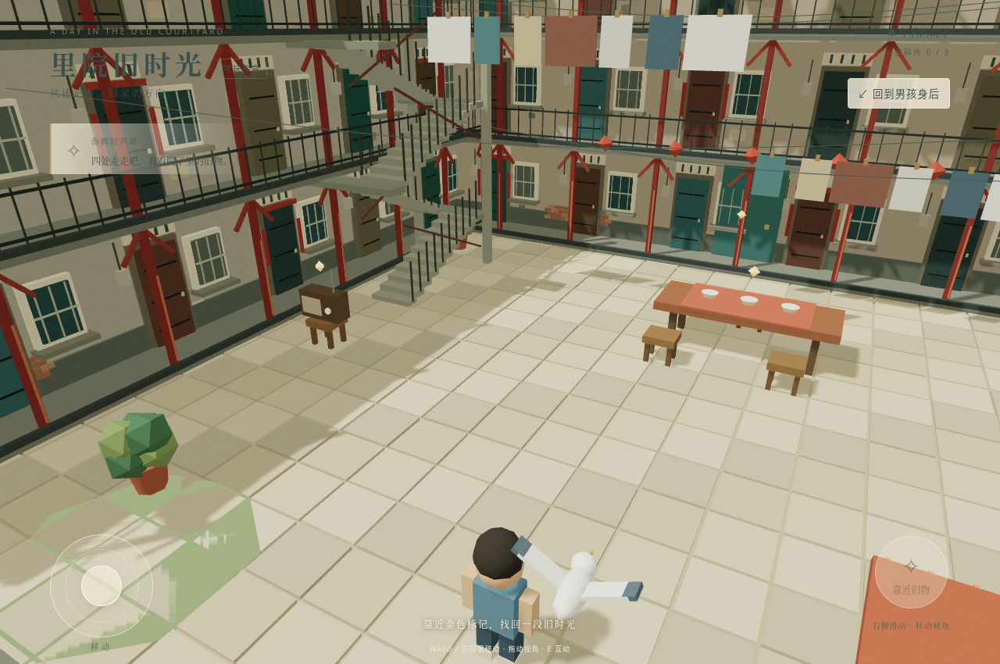

# 里院旧时光 · 3D 网页 Demo

React 19 + React Three Fiber + Three.js + Vite。程序化低模场景，无需下载模型、图片或字体。

## 在 Mac 本地启动

需要 Node.js 22.12+，推荐 Node.js 24 LTS。下载源码 ZIP，双击解压，将解压后的 `liyuan-demo` 文件夹放在“下载”目录。

在 Mac 的“终端”运行：

```bash
cd ~/Downloads/liyuan-demo
npm ci
npm run dev -- --port 5173
```

保持终端开启，然后在 Safari 打开 http://localhost:5173/ 。这里的 localhost 指你的 Mac；云端启动的服务器不能通过 Mac 的 localhost 访问。

若文件夹位于其他位置，可以在终端输入 `cd `（后面有空格），将文件夹拖入终端，再按回车。随后运行上面两条 npm 命令。

如果提示找不到 npm，先从 https://nodejs.org/ 安装 Node.js LTS，再重新打开终端。服务器默认监听 `0.0.0.0`。手机与 Mac 连同一 Wi-Fi 后，可使用 `http://Mac局域网IP:5173/` 打开；注意 macOS 防火墙的入站连接提示。

## 云端启动

```bash
cd /workspace/liyuan
npm ci --cache /workspace/.npm-cache
npm run dev -- --port 5173
```

该地址仅在云机器内部可达。外部浏览器需要平台提供的端口转发或公开 HTTPS 预览入口，不能直接访问云机器 localhost 或私网 IP。

生产构建：`npm run build`；构建预览：`npm run preview -- --port 4173`。

## 操作

- 点击“开始游戏”观看 3D 开场，等待“推开门”，最后点击“开始探索”。可跳过开场；推荐手机横屏，竖屏也有适配。
- 左下摇杆移动，右侧空白处拖动调整镜头，支持多指同时移动和转向。
- 桌面支持 WASD / 方向键移动、鼠标拖动转向、E 键互动。
- 靠近金色标记（旧收音机、喜宴长桌、回家的门）后，点击“听听故事”。
- 对话期间停止移动；点击“再走走”继续。三处互动各计一次记忆。

## 当前范围

包含三层里院、两侧可连续步行的折返楼梯、可绕行的二三层外廊、一间可进入的二层房间、晾衣与植物、临时男孩、跟随海鸥和三个物品对话。人物、地面、斜坡、楼板、墙和护栏采用 Rapier 统一碰撞；相机另包含实际建筑几何避障。建筑与地砖采用实例化渲染。

角色和场景均为程序化临时资产，并非用户角色原图的一比一模型，也非考据完成的特定院址复原。当前可从西楼梯上楼、绕外廊进入北侧二层敞开的房间，再从东楼梯返回；两侧都能继续上到三层。其他房门未开放；没有完整剧情、音频、存档或跨会话进度。阴影和后续美术仍需真机性能优化。

开发模式提供只读状态快照 `window.__LIYUAN_STATE__`，用于浏览器验证移动、跟随和镜头；生产构建不设置该快照。

## 照片参考场景更新

按用户提供的里院内部照片细化了三层红柱回廊、斜撑、铁栏杆、左侧折返楼梯、分户门窗、电表、局部砖墙、交错晾衣线、瓦顶杂屋与洗涤台。保留照片中的空间特征，并非按测量数据等比例复原。建筑细节采用实例化渲染。点击右上角“看看整座里院”可切换较高观察视角，再次点击返回第三人称。

V2 第一阶段已将折返楼梯和回廊接入物理，开放连续多层行走；原有三处互动保持可达，并增加楼层高度判断，避免隔层触发。



## V2 第一阶段：移动修复与验证

详细实现、测试方法与限制见 [阶段验证报告](docs/stage1-validation.md)。修改前恢复分支为 `backup/before-v2-stage1`。

```bash
npm ci
npm run test:physics
# 首次使用需要安装浏览器；本环境通过 CHROMIUM_PATH=/usr/bin/chromium 使用已有 Chromium。
npx playwright install chromium
npm run test:browser
npm run build
```

浏览器自动化使用真实键盘/触屏事件与同一个生产控制器的加速固定步长，另检查实时半坡停走；不设置角色楼层或传送位置。测试不等同于 iPhone Safari 真机验收或手机性能验收。三条故事、街道、NPC 与存档留给后续阶段。

`npm run deploy` 构建后推送到现有 `gh-pages` 分支，源码仍位于 `main`。Vite 已固定 `base: '/liyuan/'`，本地开发入口为 `http://localhost:5173/liyuan/`，根路径通常会自动跳转。线上地址维持 https://junyuzheng62-wq.github.io/liyuan/ 。部署脚本不会开启 Pages 设置，也不能证明公网已发布。

## 3D 开场动画

新增约 55 秒自动过场（不含等待推门的时间）：2026 商业街返乡约 15 秒 → 停留与回望约 15 秒 → 寻门约 10 秒 → 玩家推门后约 15 秒穿越回童年。开场可跳过，并可在进入探索前重看。所有人物、木门、商铺和院落均为 Three.js 实际 3D 场景。字幕完整，声音开关控制程序合成的轻微街道底噪、海风和自行车铃；没有真人旁白、居民对话或儿童笑声音频素材。

复用现有男孩、海鸥和院落视觉组件。中年人为同风格临时模型，未导入或还原尚未提供的正式角色资源。现代商业街与镜头中的居民仅用于此次过场，不作为新增可探索地图或 NPC 游戏系统。

测试：`npm run test:opening`。包含时间线连续性检查与实际等待四幕完整播放的 Chromium 手机触控模拟；检查关节、门角度、场景/人物淡化、跳过、重看、静音及原游戏交接。详情见 [开场验证报告](docs/opening-validation.md)。现有 `test:browser` 和 `test:production` 通过新入口进入探索，原移动检查保留。

原入口 https://junyuzheng62-wq.github.io/liyuan/ ，`/liyuan/z/` 提供静态跳转。恢复分支为 `backup/before-opening-animation`。
