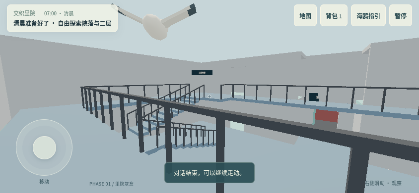
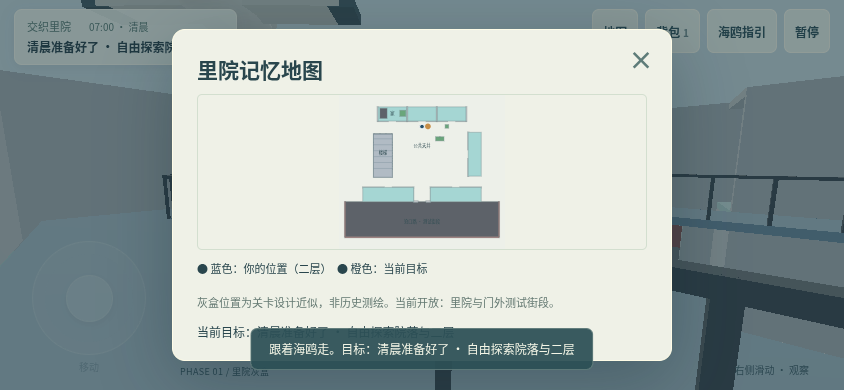

# 交织里院 · Phase 1 灰盒

本轮按用户确认，先沿用 React + React Three Fiber + Three.js + Rapier 提供可运行的手机网页；Unity 迁移留待后续。云端有 Blender 4.3.2，没有 Unity Editor，也没有 Unity 构建授权。本次未生成、编译或测试 Unity 工程。

新入口：<https://junyuzheng62-wq.github.io/liyuan/graybox/>

旧版《里院旧时光》的根入口、开场与第三人称探索保留。恢复分支 `backup/before-connect-graybox` 指向修改前的 `9c604f5`。本次地图为原创关卡灰盒，20 m × 16 m 只是测试尺度，不代表沧口路某座建筑的实测复原。

## 当前可玩流程

可选摄像头／跳过扫描 → 模拟匹配 → 约 20 秒真实 3D 简化穿越（可跳过）→ 家中第一人称 → 开房门 → 与母亲交谈 → 拾桶 → 水龙头接水 → 把水送到家中小桌 → 拿书包 → 自由探索里院、二层房间与门外测试街段。

扫描 UI 明确标记为模拟，不识别或上传图片。调用 `getUserMedia` 前需点击按钮；拒绝、缺少摄像头、无权限均可用示范地图进入。结束／跳过／离开入口时停止所有视频轨道。

首次探索默认视高 1.2 m、步速 2.15 m/s。左摇杆和右侧拖动支持同时操作；桌面 WASD／方向键移动，鼠标拖动观察，E 互动。准星对准近处目标后显示交互按钮；最远 2 m，碰撞射线阻止隔墙、隔门和隔楼板互动。

包含三名可交谈的占位居民（母亲、邻居阿姨、楼上的爷爷）、海鸥跟随与任务指路、简易地图、背包与水桶记忆、暂停、画质和灵敏度设置、减少开场镜头运动、5 秒自动存档和保存退出。流水有可见几何动画和程序合成声音。无真人语音。

## 空间与碰撞

- Blender 中建立可编辑的独立基础体模块，输出一个轻量 GLB；网页合并相同材质的静态几何，减少绘制调用。
- 院门、过道、天井、三间北侧居民房、东南翼基础房间、二层四边外廊、折返楼梯真实相连。北侧上下两层均有可开启的门。
- 楼梯视觉为台阶，物理为两段连续斜坡；统一 CharacterController、重力、接地与低台阶处理。相机位于角色胶囊内部，采用第一人称，无第三人称相机穿墙臂。
- 房门使用与可见门板同步旋转的碰撞盒；向室内开启，避免阻断外廊。关门时检查玩家是否占据门区。
- 外廊护栏为可见简单栏杆和连续隐形碰撞体，转角保留连通开口。
- 正常行走没有楼层瞬移；仅新游戏、读取存档和越界恢复会设置起点。

## 文件

| 文件 | 用途 |
| --- | --- |
| `design/blockout/generate_layout.py`、`layout.json` | 尺寸、模块、碰撞、门、NPC／交互锚点的统一来源 |
| `design/blockout/build_blender.py`、`liyuan-phase1.blend` | Blender 生成脚本与可编辑灰盒 |
| `public/graybox/liyuan-phase1.glb` | 实际加载的 Blender 建筑资产，341,368 bytes、2,688 三角形、6 材质 |
| `graybox/index.html`、`vite.config.js` | 同仓库双入口构建与 `/liyuan/` 部署路径 |
| `src/graybox/Scene.jsx`、`physics.js` | GLB、真实 3D 过场、第一人称相机、角色碰撞、门、NPC、海鸥 |
| `src/graybox/Scanner.jsx`、`TouchControls.jsx` | 可选摄像头与触屏控制 |
| `src/graybox/progress.js`、`main.jsx`、`Map.jsx`、`style.css` | 清晨流程、交互、保存、手机 UI |
| `tests/graybox/` | 碰撞、完整清晨流程与生产构建测试 |

模块 ID、米制坐标和交互逻辑分开，后续可以让 Unity 读取布局，或将 Blender 导出为合适格式；现在不依赖 Tripo 或付费生成资产。人物和海鸥复用原项目临时低模，未声称还原正式设计。

## 可重复验证

```bash
npm ci
npm run build:blockout         # 需要 python3 和 Blender；已有 .blend / GLB 无须重建
npm run test:graybox           # 自动启动／关闭开发测试服务器
npm run build
npm run test:graybox:production
npm run test:production        # 原游戏回归
```

测试使用本环境 `/usr/bin/chromium`；可通过 `CHROMIUM_PATH` 指定其他 Chromium。

| 检查 | 结果 |
| --- | --- |
| Blender 无界面生成、导出、预览图 | 通过 |
| 街道进院、连续十次上楼／外廊绕行／二层房间／下楼、街道返回 | 通过；28,114 次物理步进，0 次重生 |
| 半坡停止、闭门阻挡、墙／楼板射线遮挡 | 通过 |
| 浏览器完整 20 秒过场、人物和海鸥实际运动、1.2 m 第一人称交接 | 通过 |
| 摄像头拒绝后使用示范地图 | 通过 |
| 手机双指同时摇杆移动和转向 | 通过（真实 CDP 触控事件） |
| 开门、三名 NPC、拾桶、接水、送水、拿书包和解锁记忆 | 通过 |
| 浏览器上下楼、半坡实时停留、上层房间、出院门 | 通过 |
| 暂停／地图／背包／海鸥按钮、退出后刷新继续 | 通过 |
| 844×390、568×320、390×664、320×568 控件边界 | 通过 |
| 生产摄像头预览、模拟识别、视频轨道停止、跳过动画 | 通过（Chromium 合成摄像头设备） |
| 生产 GLB／脚本路径、设置存储、开发测试接口不进入构建 | 通过 |
| 原游戏生产构建入口与移动端控件回归 | 通过 |

十次上下楼为同一生产物理控制器的自动数值回归。浏览器长距离路线使用真实键盘／鼠标控制并通过仅开发环境的固定步长接口加速物理；未通过设置楼层或传送坐标完成。双指触屏和半坡停留另按真实时间检查。开场按真实时间播放。

这不等于 iPhone Safari 真机验收，也未测定中端手机 30 FPS。低画质默认 DPR 1，无实时阴影、无高成本后处理；保留现有 Rapier WASM 与 Three.js 基础包体，构建仍有大包提示。

## 本阶段边界

这次完成 **Phase 1 里院核心**，并接通用于测试的扫描／简化开场、存档和地图。只推进清晨准备流程，时间停留在 07:00，完成后可在院内继续探索。

学校、公园、市场、电影院、小卖部的连接和内部、购买／踢球／检票，以及从清晨到傍晚的完整一天尚未实现。门外仅是有边界的测试街段；没有把未开放地点伪装成可达建筑。完整日程和最终记忆地图结局要在后续阶段完成，Unity、Tripo 正式替换也未开始。

GitHub Pages 使用现有 `gh-pages` 发布流程。推送成功表示构建已上传，不等于公网检查成功；本云端代理限制访问 `github.io`，需从外部浏览器打开上面的入口验证发布传播。

## 实际运行截图




