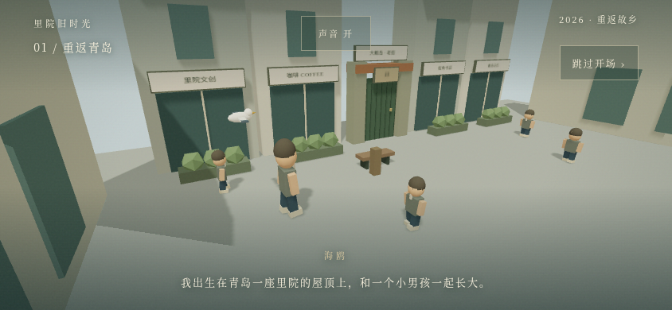
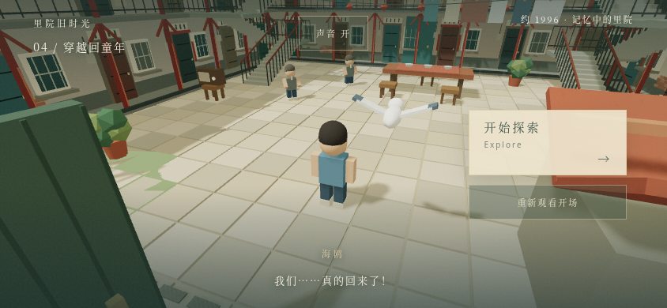

# 3D Opening Animation：实施与验证

本次仅新增开场，不实施日常、婚礼、春节或其他游戏系统。修改前恢复分支为 `backup/before-opening-animation`。

## 现有资源与入口

原项目只有程序化低模男孩、海鸥及里院，没有正式 GLB/FBX 中年角色或真人声音文件。将原有几何提取为可复用视觉组件；男孩和海鸥保留原模型外观，中年人是相同风格的临时骨骼模型，不声称还原用户尚未提供的正式角色。

原入口是 `/liyuan/`；新增 `public/z/index.html`，让 `/liyuan/z/` 跳转到同一入口，继续沿用 GitHub Pages 的 `/liyuan/` base。

## 修改文件

| 文件 | 用途 |
|---|---|
| `src/opening/Opening.jsx` | 标题、开始、字幕、推门、跳过、重看、声音开关及探索按钮 |
| `src/opening/timeline.js` | 连续的相机与人物路径、四幕字幕、推门角度、年代与年龄叠化 |
| `src/opening/OpeningScene.jsx` | 实际 3D 商业街、主角、海鸥、游客、木门、过去里院与居民；关节和材质动画 |
| `src/opening/OpeningSound.js` | 仅开场使用的 Web Audio 环境底噪、风声与合成自行车铃，时代渐变与静音 |
| `src/opening/opening.css` | 横竖屏、安全边距、字幕及过场界面 |
| `src/CharacterModels.jsx` | 从原入口提取的男孩、海鸥、盒体绘制；复用为过场占位角色 |
| `src/Courtyard.jsx` | 原院落视觉组件原样提取，供过场与原探索共用 |
| `src/main.jsx` | 接入开场，再挂载现有探索；等待原物理初始化完成后放开输入 |
| `public/z/index.html` | 原请求中的 `/z` 入口兼容跳转 |
| `tests/opening.test.mjs` / `tests/opening-browser.mjs` | 连续性与实际完整播放验证 |
| `tests/enter-exploration.mjs` | 现有回归测试通过新入口进入游戏，原测试断言保留 |

原有 `PlayerMotion.jsx`、`physics.js`、`worldLayout.js`、`Architecture.jsx`、`architectureData.js`、`movement.js` 与 `vite.config.js` 对比恢复分支均无修改。

## 实际流程

1. 标题画面有“开始游戏”；探索控制尚未挂载。
2. 约 15 秒：现代街景中的男人与海鸥行走，相机从远景推进到侧面。
3. 约 15 秒：男人停留、转身与回望；海鸥绕行并落在街边木柱上。
4. 约 10 秒：人物走到老门前；时间线停住，等待玩家点击“推开门”。
5. 点击后约 15 秒：手臂推动、门轴转动、相机进门；现代材质淡出，旧院落和居民渐入；中年与童年模型叠化，海鸥保持同一模型。
6. 展示“开始探索”，玩家点击后进入原有第三人称探索。可在进入探索前重看，也可随时跳过过场到探索确认画面。

四幕为实时 Three.js 场景；CSS 用于字幕、按钮和轻微暗角/颗粒，未用图片或文字幻灯片代替场景运动。时长不含标题、推门和探索确认等待；低帧率机器可能延长播放时间。后台暂停推进，返回时不会跳过整幕。

## 验证与复现

```bash
npm run test:opening
npm run test:physics
MOVEMENT_CYCLES=1 npm run test:browser
npm run build
npm run test:production
```

首次运行浏览器测试需 `npx playwright install chromium`，或设置 `CHROMIUM_PATH` 使用已有 Chromium。

- 时间线测试检查相机、人物在镜头交界和推门前后的连续性，以及门角度、年代/年龄叠化终点。
- 开场浏览器测试实际等待完整四幕播放，没有 seek 或加速时间线。检查实际 3D 人物与相机坐标变化、海鸥飞行与停驻、推门关节和门角度、成人/男孩材质透明度与同一海鸥实例。
- 检查推门前不会自行穿越，也不能提前进入探索；检查跳过、重看、声音开关以及 844×390、568×320、390×664、320×568 的按钮边界。
- 检查点击探索后，原 Rapier 场景挂载并能真实触屏移动；原有楼梯、外廊、房间和收音机互动另做桌面/触屏回归。
- 生产检查包括 `/liyuan/` 资源、WebGL/WASM 初始化、横竖屏、`/z/` 跳转和测试接口不进入发布构建。

本次最终结果：

| 检查 | 结果 |
|---|---|
| 开始标题与按钮 | 通过 |
| 完整实时四幕播放，实际人物/相机/海鸥运动 | 通过 |
| 等待点击、伸手动作、门轴转动 | 通过 |
| 现代/过去场景渐变、中年/男孩叠化 | 通过 |
| 环境声渐变、静音、同一海鸥实例 | 通过 |
| 跳过、重看、探索确认 | 通过 |
| 探索交接及实际触屏移动 | 通过 |
| 四种手机尺寸的按钮边界 | 通过 |
| JavaScript 运行错误 | 0 |
| 原物理路径十轮 | 通过 |
| 原楼梯/外廊/房间/互动浏览器回归 | 桌面与触控各一轮通过 |
| 生产构建、资源路径、横竖屏与 `/z` 跳转 | 通过 |

实际截图保留于 `test-results/opening-*.png`，报告在同目录 `opening-report.json`。测试环境是 Linux Chromium 软件渲染及手机触控模拟，不是 iPhone Safari 人工或真机验收。

## 素材与范围限制

角色为占位模型；现代商铺和过场中的居民为本片创作场景，并非新增可探索街道或 NPC 行为系统。旁白完整使用字幕，尚无真人配音、居民聊天或儿童笑声录音；环境声为程序合成的轻微底噪、风声与铃声。提供静音，进入探索后关闭开场音频。

本次没有更改碰撞、楼层、任务、存档或其他玩法。GitHub Pages 发布分支推送成功和公网实际生效分别记录，不能以构建成功代替公网验证。

## 实际浏览器画面




