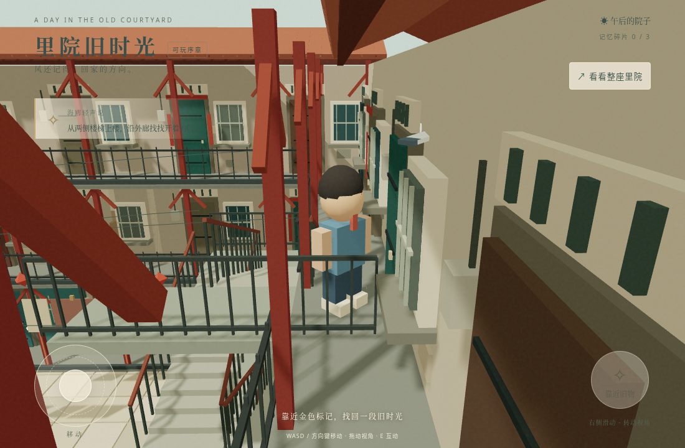

# V2 第一阶段：多层移动与相机修复

## 修改前检查

恢复分支：`backup/before-v2-stage1`，指向 `0aa590d`。

已有：程序化低模三层里院、占位男孩、自动跟随海鸥、触屏摇杆与拖动相机、WASD/方向键、三处旧物对话、手机布局、main 源码分支与 gh-pages 静态发布分支。

未有：可行走上层、房间内部、开场穿越动画、院外街巷和学校、三条完整剧情、NPC 日程、昼夜推进、存档和暂停。这里只实现第一阶段的移动基础与一间可进入样板房，不将其余阶段宣称为已完成。

问题根因：旧移动只修改 X/Z；楼梯区域被二维禁行判断封锁；台阶仅是绘制模型；上层楼板、栏杆和墙壁无统一物理数据；相机只限制院落矩形边界；旧交互忽略高度差。

## 最终实现

- `src/worldLayout.js`：统一三层标高、两侧折返楼梯、平台、外廊、栏杆、样板房及道具碰撞。楼梯台阶由相同参数生成；隐形连续薄斜坡与视觉踏步相配。
- `src/physics.js`：Rapier 胶囊运动学角色、固定 60Hz 步长、重力、地面检测、约 40 度最大攀爬坡度、0.21m 小台阶处理、贴地与低于世界后的恢复。主要障碍支持滑移。正常路线无需重生或传送。
- `src/PlayerMotion.jsx` / `src/movement.js`：复用键盘及多指触屏输入；相机焦点随人物实际 Y 坐标变化，球形扫掠避开墙、楼板、栏杆和实际建筑装饰，低屋顶下调整首选高度。
- `src/architectureData.js` / `src/Architecture.jsx`：保留原美术与实例化，移除装饰楼梯，打通栏杆入口和一个二层门洞；建筑盒体同时生成专用相机三角网格。角色不碰细小装饰接缝。
- `src/main.jsx`：接回原场景、海鸥和三处互动；物品必须同高度才可交互；物理引擎加载完成后才能开始，加载错误有提示。
- `vite.config.js` / `scripts/deploy.mjs`：明确 `/liyuan/` 路径，并沿用 `gh-pages` 分支发布；不重置工作分支，不强推。

房间入口：二层北侧外廊的敞开绿门。两侧楼梯从院内靠近北墙处进入，可上至三层。三层保留门窗，但只二层样板房可进入。

## 验证方式

`tests/movement.test.mjs` 调用生产使用的 Rapier 控制器，以固定步长移动，并逐帧检查高度连续性。十轮路径：院子 → 西楼梯 → 二层西/北外廊 → 二层房间 → 北/东外廊 → 东楼梯 → 院子。另检查三层、半坡停走、栏杆阻挡、相机墙体阻挡和异常跌落恢复。

`tests/browser-movement.mjs` 使用 Playwright Chromium。桌面发真实键盘事件，手机模式通过 CDP 发真实触屏事件；测试专用接口只加速同一个生产控制器的物理步进，不设置楼层或位置。每种模式各运行十轮，并检查三层、房间、相机扫掠和原收音机互动。各模式首轮另关闭加速，运行实时上坡、松手停住、再继续上坡。加速步进不作为长时间实时操控或实际手机性能测试的替代。

专用测试接口仅开发构建可用，生产构建没有该入口。普通游玩始终由实时帧循环驱动物理。

运行环境的浏览器为 Linux Chromium 软件渲染，不是 iPhone Safari。不得据此声称真机帧率或完全无视觉遮挡。截图与 JSON 报告写入忽略的 `test-results/`。

## 结果

- `npm run test:physics`：十轮上下楼、三层、二层房间、半坡停止、护栏、实际屋顶/立柱相机检测、异常跌落恢复均通过。最终增加一层外廊高差检查，共执行 18,442 个移动步；最大单步高度变化约 0.0482m。正常路径没有调用重生。
- `npm run test:browser`：Chromium 桌面键盘 10/10 轮、手机触控模式 10/10 轮通过；每种模式另通过三层、实时半坡松手/继续、房间、相机约束和原收音机互动。JavaScript 错误为零。
- 最后调整一层外廊碰撞与平台护栏视觉后，通过 `MOVEMENT_CYCLES=1 npm run test:browser` 对两种输入模式再做完整路径复查，包含新增的一层外廊绕行；与十轮报告分别保留，不用短检查替代长回归。
- `npm run build`：通过。输出含延迟加载 Rapier 的大资源体积警告，未关闭该警告；真机性能未验证。
- `npm run test:production`：生产 `/liyuan/` 路径下，390×664 竖屏、844×390 横屏的 WebGL、WASM 初始化、资源加载、按钮边界与观察视角切换通过，开发测试接口未进入发布版。

复现命令见 README。自动化不是人工试玩，更不代表已在 iPhone Safari 真机验收。

## 已知范围与限制

- 只开放一间二层样板房，不是所有门都能进入。院门外、学校和其他故事属于后续阶段。
- 人物和海鸥仍为原占位模型，没有收到正式 3D 模型，也未声称角色还原。
- 窄外廊和小房间的镜头会主动拉近，接近墙角仍需实际设备进一步检查。
- 本阶段没有加入完整暂停/存档或新剧情，不改变三段旧物回忆的流程。
- Rapier WASM 随包内嵌，首次加载比旧版更大；已延迟加载并显示状态，但真机内存与性能尚待测试。
- 自动化能验证碰撞与相机几何约束，不能证明每个可能视角都没有装饰遮挡。
- Pages 分支上传与线上可用性分别报告，受网络限制时不声称已验证公网。

## 实际渲染截图

